Name: Sacenov Aldiyar  
Group: IT-2501  

Task 0 - Setup

I included jQuery from a CDN and used $(document).ready(). The browser console prints jQuery is ready! when the page loads.

 Task 1 — Selectors and CSS

I used ID, class and tag selectors, updated the greeting with .text(), and applied styles with .css(). The buttons switch between light and dark themes.

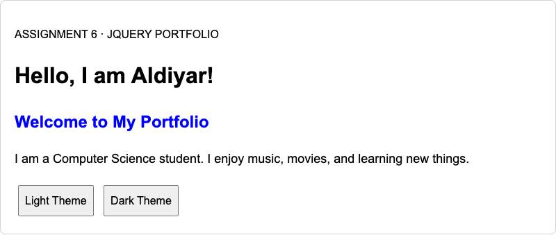
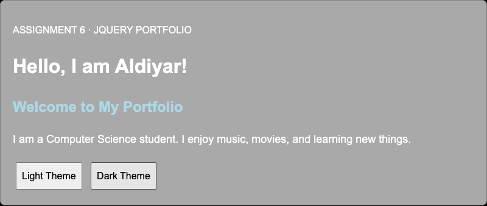

Task 2 — Visibility

The About Me section contains my biography, status and fun facts. Hide, Show and Toggle control the facts using .hide(), .show() and .toggle().

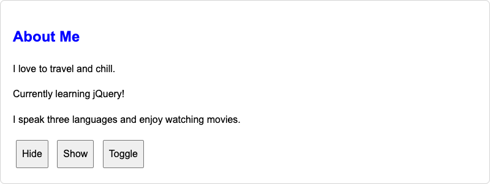
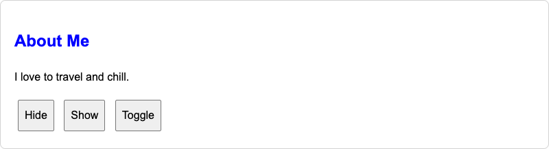

 Task 3 — Fade Effects

My gallery shows photos of Prague and Vienna. The buttons use .fadeIn(), .fadeOut() and .fadeToggle().

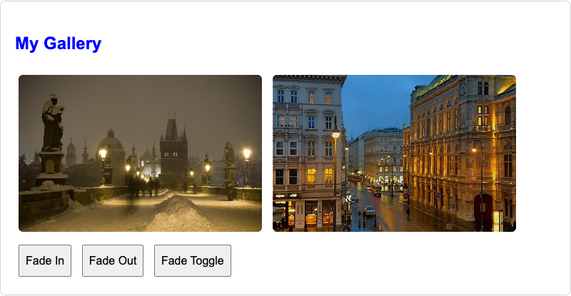
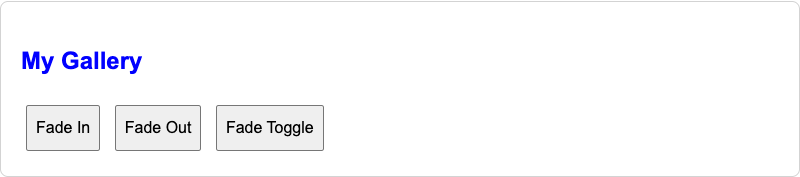

Task 4 — Slide Effects

Three clickable headings reveal my favorite music, movie and subject. The panels use .slideUp(), .slideDown() and .slideToggle().

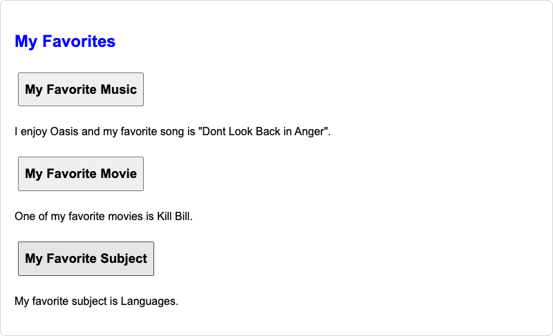
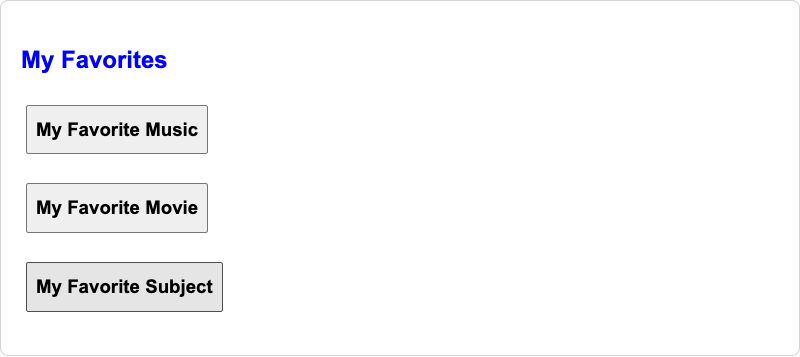

Task 5 — Add and Remove Skills

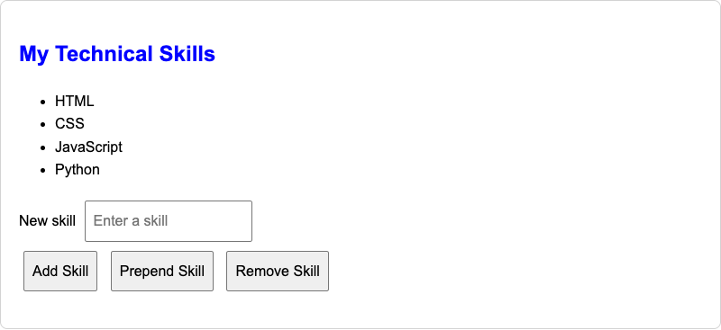
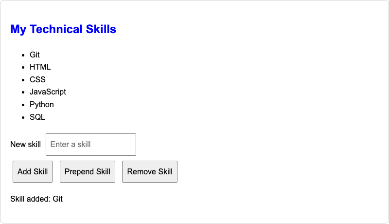
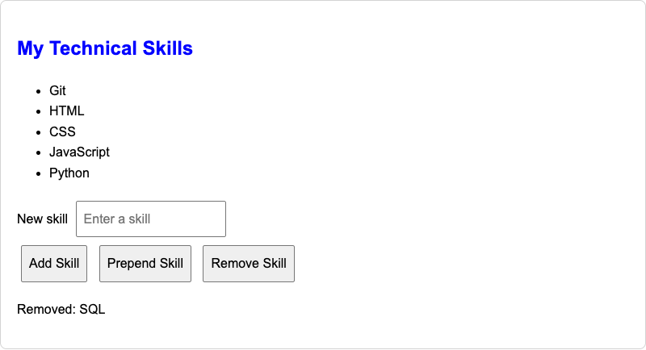
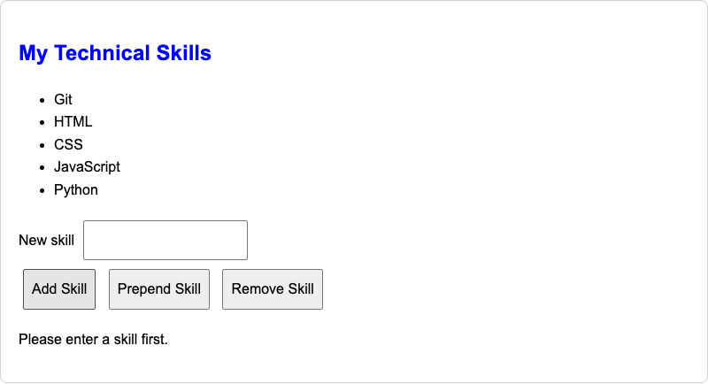

 Task 6 — Modifying Attributes

The button changes the social link between Instagram and GitHub using `.attr()` and updates its text.

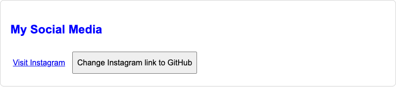
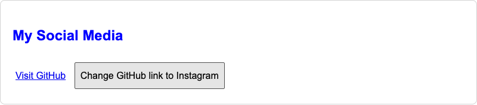

Task 7 — Form Interaction

Name and email appear live below the form using .val() and .text(). The form is a local preview and does not send data.

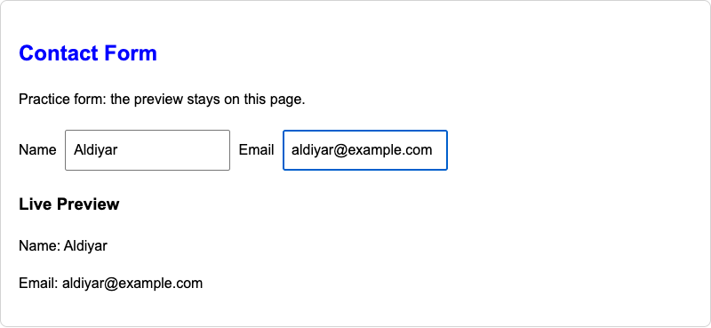

Task 8 — Skill Bars

The bars start at zero width. Clicking Animate My Skills uses `.animate()` to reach 90% for HTML, 70% for CSS and 60% for JavaScript. Clicking again returns them to zero.

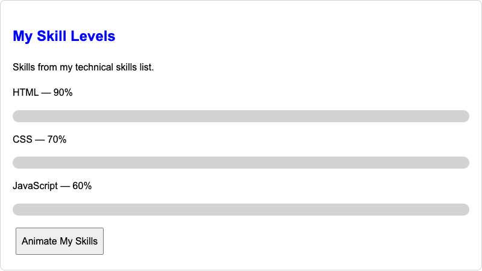
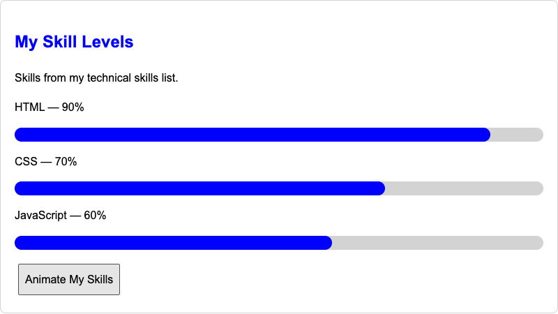

Summary

I created the portfolio sections, connected the buttons with jQuery, and added effects, list editing, a live form preview and animated skill bars. I tested the interactions and captured screenshots of each task.
